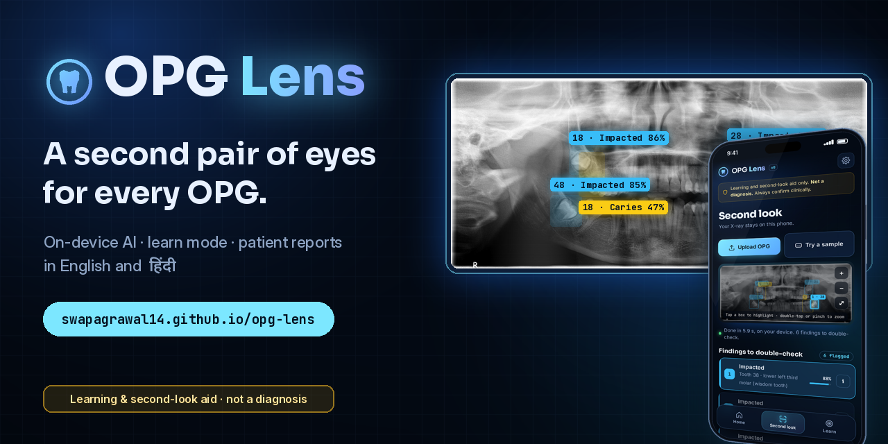
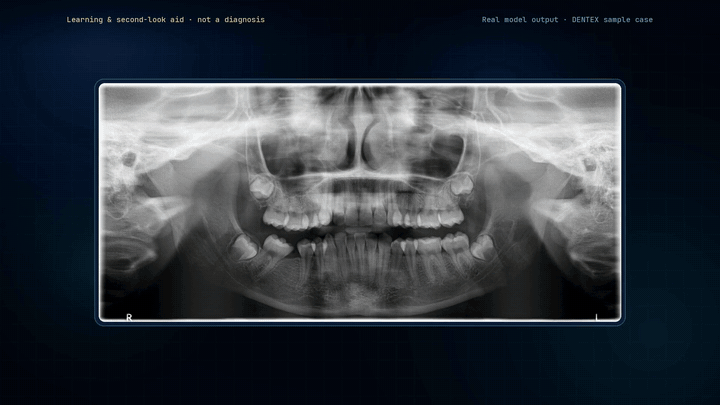
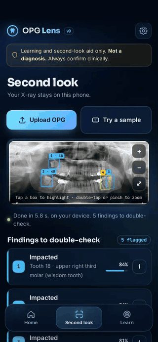
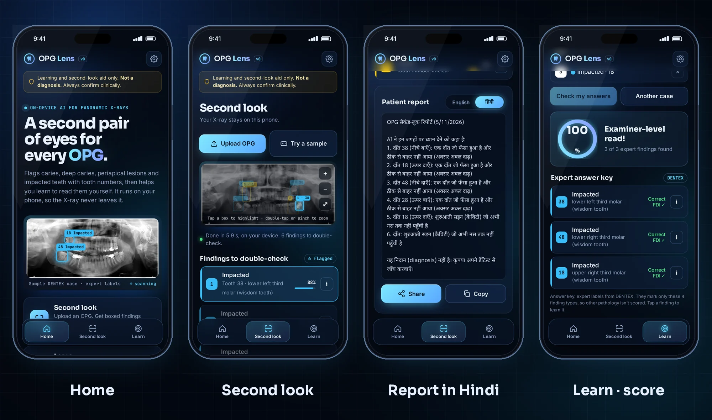
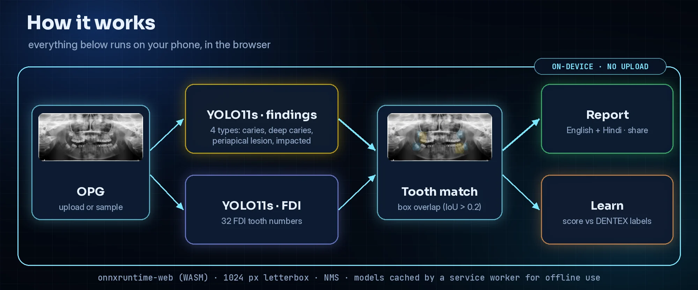

<p align="center">
  <a href="https://swapagrawal14.github.io/opg-lens/"></a>
</p>

<p align="center">
  <a href="https://swapagrawal14.github.io/opg-lens/"><b>Open the app</b></a> ·
  <a href="docs/opg-lens-launch-720p.mp4"><b>Watch the launch film (59 s)</b></a> ·
  <a href="#how-it-works">How it works</a> ·
  <a href="#models-v0">Models</a> ·
  <a href="#privacy">Privacy</a>
</p>

<p align="center">
  
  
  
  
</p>

> [!IMPORTANT]
> **Not a diagnosis.** OPG Lens is a learning aid for dental students and a second-look aid for clinicians. It is not a medical device and it can miss findings or flag things that are not there. Always confirm clinically and with appropriate radiographs.

**OPG Lens** is a free, phone-first web app for dental panoramic radiographs (OPGs). It boxes caries, deep caries, periapical lesions and impacted teeth with FDI tooth numbers, writes a plain-language patient report in English and Hindi, and turns OPG reading into a daily game with expert-labelled cases. The models run inside your browser, so **the X-ray never leaves your phone.**

Built by **Dr. Swapnil Agrawal, BDS** (dental intern, Udaipur) with free tools and open data.

## Launch film

<p align="center">
  <a href="docs/opg-lens-launch-720p.mp4"></a><br>
  <sub>Teaser loop. <a href="docs/opg-lens-launch-720p.mp4">Play the full 59-second film with sound (720p MP4, 6 MB)</a>. The boxes are real model output on a DENTEX sample case.</sub>
</p>

## See it in action

<table>
<tr>
<td width="34%" align="center"></td>
<td>

**Second look**
- Upload an OPG or try one of 8 DENTEX sample cases.
- Findings pop in as colour-coded boxes with an FDI number and a confidence score. Tap a box or a row to highlight it; double-tap or pinch to zoom.
- Tap **i** on any finding for a teaching card: what it looks like, why, what not to confuse it with, and the next step.
- A patient report in **English or हिंदी**, ready to copy or share.

**Learn**
- **OPG of the Day** plus unlimited practice cases.
- Tap where you see a finding, choose the finding type and the tooth on an FDI chart.
- Get scored against **DENTEX expert labels**, with a score ring, confetti for a good read, and a daily streak kept on your device.

**Bring your own AI (optional)**
- Plug in any OpenAI-compatible base URL, key and model for a tutor chat. The key stays in your browser. Sending the image to your model is opt-in.

</td>
</tr>
</table>

<p align="center"></p>

## How it works

<p align="center"></p>

1. The OPG is letterboxed to 1024 px in the browser.
2. Two **YOLO11s** detectors run with **onnxruntime-web** (WebAssembly): one for the 4 finding types, one for the 32 FDI tooth numbers.
3. Non-max suppression cleans up the boxes, then each finding is matched to a tooth by box overlap (IoU > 0.2).
4. The app writes the report from templates and the explanation cards. No server is involved.

The first visit downloads about 38 MB of models with a progress bar. A service worker then caches the app, the models and the sample cases, so it works offline and installs as a PWA.

## Models (v0)

Trained on a Kaggle T4 using the fully labelled DENTEX set (705 OPGs, 10% held out for validation). Numbers below are on that held-out split.

| Model | Classes | mAP50 | mAP50-95 |
|---|---|---|---|
| Findings | 4 | **0.557** | 0.381 |
| FDI tooth number | 32 | **0.518** | 0.357 |

| Finding | mAP50 |
|---|---|
| Impacted tooth | 0.73 |
| Periapical lesion | 0.57 |
| Deep caries | 0.50 |
| Caries | 0.43 |

**Known v0 limit:** DENTEX labels tooth numbers only for the abnormal teeth, so the FDI model learnt those and often cannot number a tooth. The app then says "Tooth number unclear". The training script is in [`training/train_v0.py`](training/train_v0.py).

## Privacy

- **The X-ray stays on your device.** Detection runs in your browser; nothing is uploaded.
- Learn-mode streaks and scores live in your browser's local storage.
- The optional AI tutor talks directly from your browser to the endpoint you choose, with your own key. The image is only sent if you tick the vision option, so use anonymised images.

## Roadmap

- **v1:** full-mouth tooth numbering (a tooth detector trained on all 32 teeth, so every finding gets a number).
- Clinician review of every explanation card (the current cards are drafts).
- NEET-MDS style radiology quiz mode and more practice cases.
- **Later:** IOPA and bitewing radiographs.

## Run it locally

```bash
git clone https://github.com/swapagrawal14/opg-lens.git
cd opg-lens
python3 -m http.server 8000   # then open http://localhost:8000
```

It is a static site: `index.html`, `style.css`, `app.js`, `content.js`, `sw.js`, the ONNX models in `models/` and the sample cases in `samples/`.

## Credits and license

- **Data:** DENTEX (Hamamci et al., *DENTEX: An Abnormal Tooth Detection with Dental Enumeration and Diagnosis Benchmark for Panoramic X-rays*, 2023), released under **CC BY-NC-SA 4.0**. The sample cases in `samples/` are DENTEX images and the Learn answer key uses its expert labels.
- **Because of this, the models, the sample cases and this project are for non-commercial use only and are shared under CC BY-NC-SA 4.0.**
- Detection: [Ultralytics YOLO11](https://github.com/ultralytics/ultralytics) · inference: [onnxruntime-web](https://onnxruntime.ai/).
- Fonts: Sora, Inter, JetBrains Mono, Noto Sans Devanagari (Google Fonts, SIL Open Font License).
- Launch film: music "Ramp It Up" by Ahjay Stelino ([Mixkit Free License](https://mixkit.co/license/#musicFree)); voice by Microsoft Edge neural TTS (en-IN Neerja) via edge-tts; animated frame by frame in Python (Pillow) with real model output and real captures of the app.

---

<p align="center"><sub>OPG Lens is a learning and second-look aid, not a diagnosis. It is not a medical device and makes no claim to detect all disease.</sub></p>
